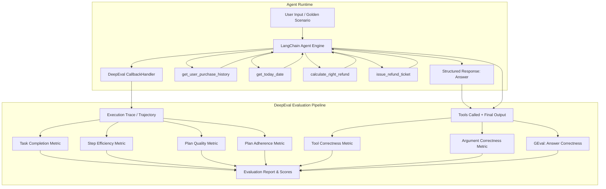

# 🤖 LangChain Agent Eval System

A production-grade, end-to-end evaluation framework and customer support agent built with **LangChain**, **LangGraph**, and **DeepEval**.

This repository implements an autonomous refund customer service agent equipped with domain-specific tools and strict business rules, benchmarked across **7 comprehensive agentic evaluation metrics** using a golden evaluation dataset.

---

## 📑 Table of Contents

- [Overview](#-overview)
- [Architecture](#-architecture)
- [Key Features](#-key-features)
- [Evaluation Framework](#-evaluation-framework)
  - [7 Evaluation Dimensions](#7-evaluation-dimensions)
  - [Evaluation Scenarios](#evaluation-scenarios)
- [Project Structure](#-project-structure)
- [Getting Started](#-getting-started)
  - [Prerequisites](#prerequisites)
  - [Installation](#installation)
  - [Environment Configuration](#environment-configuration)
- [Usage](#-usage)
  - [Running the Interactive Agent](#running-the-interactive-agent)
  - [Running Individual Evaluations](#running-individual-evaluations)
  - [Running Full Evaluation Suite](#running-full-evaluation-suite)
- [Agent Workflow & Policy](#-agent-workflow--policy)
- [Author & Acknowledgments](#-author--acknowledgments)

---

## 🔭 Overview

Evaluating LLM-based autonomous agents requires more than just checking traditional text similarity. Agents reason, plan, invoke tools in dynamic sequences, pass structured parameters, and adhere to strict organizational policies.

This system provides:
1. **Policy-Constrained LangChain Agent**: An agent built on `ChatGoogleGenerativeAI` / `ChatGroq` with memory checkpointers (`InMemorySaver`) and structured output enforcement (`Pydantic`).
2. **DeepEval Integration**: Evaluation suite using LangChain callback tracing (`CallbackHandler`) to capture trajectories, plans, and tool execution traces.
3. **Rigorous Benchmark Suite**: Multi-metric evaluation verifying task completion, execution efficiency, reasoning quality, plan adherence, tool accuracy, argument validity, and semantic correctness.

---

## 🏛 Architecture



---

## ✨ Key Features

- **Structured Output Guarantees**: Utilizes Pydantic schemas (`Answer`, `PurchaseItem`) to ensure deterministic outputs and conversation loop state tracking.
- **Trace-Level & Step-Level Evaluation**: Combines runtime callback tracing with unit-level test cases.
- **Strict Refund Policy Rules**:
  - Enforces a 30-day maximum refund window.
  - Rejects future-dated transactions.
  - Ensures identity verification before disclosing records.
  - Restricts refunds strictly to user-demanded eligible items.
- **Unified Benchmark Execution**: Run all 7 evaluation metrics across test scenarios in a single command via [`evaluations/eval_all.py`](file:///c:/Code/datawithshoaib/LangChain-Agent-Eval-System/evaluations/eval_all.py).

---

## 📊 Evaluation Framework

### 7 Evaluation Dimensions

| # | Metric | Evaluator Type | Description |
|---|--------|----------------|-------------|
| 1 | **Task Completion** | Trace-based | Assesses whether the agent satisfied all business policy requirements and customer needs. |
| 2 | **Step Efficiency** | Trace-based | Detects superfluous iterations, redundant tool queries, and suboptimal path execution. |
| 3 | **Plan Quality** | Trace-based | Measures the logical formulation and coherence of the agent's internal plan before acting. |
| 4 | **Plan Adherence** | Trace-based | Validates whether the agent strictly stuck to its generated plan throughout execution. |
| 5 | **Tool Correctness** | Test-case / Output | Compares actual tools invoked against expected tools (`expected_tools`). |
| 6 | **Argument Correctness** | Test-case / Output | Validates that tool invocation parameters (e.g. usernames, item lists, amounts) match expected schemas. |
| 7 | **Answer Correctness** | LLM-as-a-Judge (`GEval`) | Evaluates whether the generated natural language response shares the exact logical conclusion with the reference answer. |

### Evaluation Scenarios

The test dataset in [`evaluations/dataset.py`](file:///c:/Code/datawithshoaib/LangChain-Agent-Eval-System/evaluations/dataset.py) evaluates 9 realistic edge scenarios:

1. **Full Refund for Multiple Items**: User requests refund for multiple items that are within the 30-day window.
2. **Partial Order Refund**: User requests a refund for only one item out of multiple purchases (tests item-level scoping).
3. **Information-Only Inquiry**: User queries order history without requesting a refund (verifies no tickets are created).
4. **Invalid Username Lookup**: Customer provides an invalid username (verifies rejection and privacy safety).
5. **Expired Policy Window (>30 Days)**: Item purchased beyond the 30-day threshold (verifies rejection).
6. **Mixed Eligibility**: One item is eligible, but another is expired (tests partial refund accuracy).
7. **Non-Existent Item**: User requests refund for an item they never purchased.
8. **Future-Dated Item**: Invalid purchase date in the future (tests boundary validation).
9. **Boundary Case (Exact 30 Days)**: Evaluates purchase eligibility on the boundary of the policy.

---

## 📁 Project Structure

```text
LangChain-Agent-Eval-System/
├── agent/
│   ├── agent.py         # Agent creation (create_agent), memory saver, and interactive CLI loop
│   ├── data.py          # Mock database of user purchases and dates
│   ├── models.py        # Chat model (Google Gemini / Groq) and evaluator model configuration
│   ├── objects.py       # Pydantic schemas (Answer, PurchaseItem)
│   ├── prompts.py       # Comprehensive system prompts and policy guidelines
│   └── tools.py         # Custom LangChain tools (history, refund calculation, ticket issuance, date)
├── evaluations/
│   ├── 1_task_completion.py       # Task completion metric evaluator
│   ├── 2_step_efficiency.py       # Step efficiency metric evaluator
│   ├── 3_plan_quality.py          # Plan quality metric evaluator
│   ├── 4_plan_adherence.py        # Plan adherence metric evaluator
│   ├── 5_tool_correctness.py      # Tool correctness evaluation
│   ├── 6_argument_correctness.py  # Argument correctness evaluation
│   ├── 7_answer_correctness.py    # GEval answer correctness evaluation
│   ├── dataset.py                 # DeepEval golden dataset with 9 edge-case scenarios
│   └── eval_all.py                # Unified evaluation runner executing all 7 metrics
├── src/
│   └── langchain_agent_eval_system/
│       └── __init__.py            # Package entrypoint
├── .env.example                   # Template for environment credentials
├── pyproject.toml                 # Project metadata, dependencies, and script declarations
└── README.md                      # Project documentation
```

---

## 🚀 Getting Started

### Prerequisites

- **Python 3.13+**
- **uv** (recommended) or **pip**
- API keys:
  - [Google AI Studio API Key](https://aistudio.google.com/) (for Gemini)
  - [Groq API Key](https://console.groq.com/) (optional/alternative)
  - API key for the evaluator model (e.g. OpenAI / Gemini configured in DeepEval)

### Installation

#### Using `uv` (Recommended)

```bash
# Clone the repository
git clone https://github.com/datawithshoaib/LangChain-Agent-Eval-System.git
cd LangChain-Agent-Eval-System

# Create virtual environment and sync dependencies
uv sync
```

#### Using Standard `venv` & `pip`

```bash
python -m venv .venv

# Windows (PowerShell)
.venv\Scripts\Activate.ps1

# Linux / macOS
source .venv/bin/activate

pip install -e .
```

### Environment Configuration

Copy the sample environment file and configure your API keys:

```bash
cp .env.example .env
```

Populate `.env` with your active keys:

```env
GEMINI_API_KEY="your_gemini_api_key"
GROQ_API_KEY="your_groq_api_key"
OPENAI_API_KEY="your_openai_api_key"  # If using OpenAI as DeepEval judge
```

---

## 💻 Usage

### Running the Interactive Agent

Test the customer support refund agent interactively in your terminal:

```bash
python agent/agent.py
```

**Example Conversation Flow:**
```text
Agent: Hello, I would like to request a refund for my recent purchase.
User: I am user123, I would like a refund for the book.
Agent: A refund ticket has been issued for $23 for book. The refund should arrive in your bank account according to the applicable processing timeline.
Conversation ended. Thank you for using our refund service.
```

### Running Individual Evaluations

You can run individual metric evaluations from the `evaluations/` directory:

```bash
# Evaluate Task Completion
python evaluations/1_task_completion.py

# Evaluate Tool Call Correctness
python evaluations/5_tool_correctness.py

# Evaluate Tool Argument Correctness
python evaluations/6_argument_correctness.py

# Evaluate Answer Correctness (GEval)
python evaluations/7_answer_correctness.py
```

### Running Full Evaluation Suite

Execute all 7 metrics across the entire golden dataset in a single unified run:

```bash
python evaluations/eval_all.py
```

This will run trace-based metrics through the callback handler, followed by single-turn metrics, printing complete evaluation summaries and scores.

---

## 📋 Agent Workflow & Policy

The agent strictly follows a 7-step deterministic decision sequence:

1. **Step 1: Obtain Current Date** &rarr; Invocations of [`get_today_date`](file:///c:/Code/datawithshoaib/LangChain-Agent-Eval-System/agent/tools.py#L63-L68) (never assumes or invents today's date).
2. **Step 2: Verify Customer Identity** &rarr; Retrieves records with [`get_user_purchase_history`](file:///c:/Code/datawithshoaib/LangChain-Agent-Eval-System/agent/tools.py#L16-L26). If unknown, prompts customer for valid credentials.
3. **Step 3: Identify Requested Purchase** &rarr; Matches requested items to confirmed customer history.
4. **Step 4: Check Eligibility** &rarr; Rejects purchases older than 30 days or dated in the future.
5. **Step 5: Calculate Refund** &rarr; Calls [`calculate_right_refund`](file:///c:/Code/datawithshoaib/LangChain-Agent-Eval-System/agent/tools.py#L28-L50) to verify exact eligible monetary amount.
6. **Step 6: Issue Refund Ticket** &rarr; Invocations of [`issue_refund_ticket`](file:///c:/Code/datawithshoaib/LangChain-Agent-Eval-System/agent/tools.py#L51-L61) upon validation.
7. **Step 7: Customer Communication** &rarr; Formulates a final response following predefined communication standards.

---

## 👤 Author & Acknowledgments

- **Shoaib Akthar**
  - Email: [shoaibakthar.work@gmail.com](mailto:shoaibakthar.work@gmail.com)
  - GitHub: [@datawithshoaib](https://github.com/datawithshoaib)

Built with [LangChain](https://github.com/langchain-ai/langchain), [LangGraph](https://github.com/langchain-ai/langgraph), and [DeepEval](https://github.com/confident-ai/deepeval).
